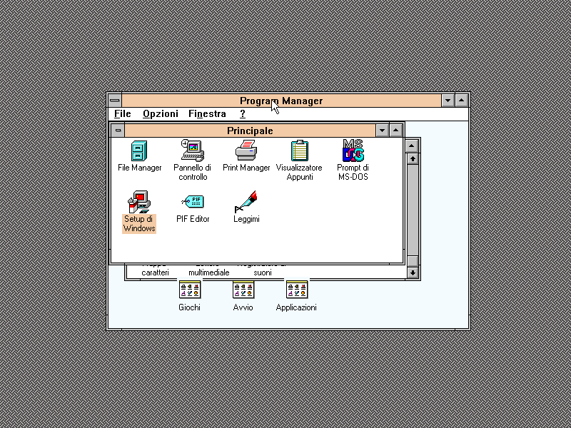

# Aurora86

An x86 PC emulator written in C#, built to be read as much as to be run.

Aurora86 started as an Intel 80386 and grew, one measured step at a time,
into a machine that spans the 386 to the Pentium 4: ISA and PCI buses, S3
graphics, Sound Blaster and AudioPCI sound, NE2000 and Realtek networking,
USB from UHCI to xHCI. Every device is modelled the way the real silicon
behaved, and the comments explain *why* the hardware works that way, not
just what the code does.



## Contents

- [What runs today](#what-runs-today)
- [What is emulated](#what-is-emulated)
- [Getting started](#getting-started)
- [Configuring a machine](#configuring-a-machine)
- [Installing MS-DOS](#installing-ms-dos)
- [Testing](#testing)
- [Repository layout](#repository-layout)
- [Design](#design)
- [Things the hardware does that surprise people](#things-the-hardware-does-that-surprise-people)
- [Documentation](#documentation)
- [Contributing](#contributing)
- [Licence](#licence)

## What runs today

| Guest | State |
|---|---|
| MS-DOS 6.22 | Installs from the original floppies and boots from the hard disk, with HIMEM, EMM386, SMARTDRV, KEYB, MSCDEX and an ATAPI CD-ROM driver |
| Windows 3.11 | Standard and 386 enhanced mode; the S3 driver at 800x600 and 1024x768 in 256 colours; the full-screen MS-DOS Prompt opens and returns ([check](docs/WINDOWS-DOS.md)) |
| Windows 95 | Installs from the OSR2.5 CD and reaches the desktop on the S3 Trio64V+ and the S3 ViRGE; the display work and its limits are recorded in [the video validation notes](docs/WINDOWS95-VIDEO-VALIDATION.md) |
| DOS networking | With a packet driver and mTCP, DHCP gets an address, ping reaches the outside, HTGET fetches a page |

Windows 95 is still the current goal rather than a finished one: the notes
above list what was verified, on which revision, and what is still open.

**In progress.** A modern platform aimed at booting a current Linux:
AHCI SATA, HD Audio, EHCI and xHCI USB, ACPI, the local and I/O APICs, and
x86-64 long mode. These devices pass their register-level tests but no
guest driver has used them yet, and the 64-bit CPU models do not advertise
long mode until it is complete.

## What is emulated

### Processors

| Model (`--cpu`) | What it adds |
|---|---|
| `386` | Real, protected and virtual 8086 mode, paging, task switching |
| `486` (default) | CPUID, the 486 CR0 bits, alignment check, the on-chip x87 |
| `pentium` | Time stamp counter, model-specific registers, CMPXCHG8B |
| `pentium-mmx` | MMX |
| `pentium2` | CMOV, FXSAVE/FXRSTOR, SYSENTER/SYSEXIT |
| `pentium3` | SSE |
| `pentium4` | SSE2; SSE3 is implemented for later models |

The x87 FPU is emulated in software with 80-bit extended precision
([X87.md](docs/X87.md)). CPU accuracy is measured against published test
vectors:

| Suite | Result |
|---|---|
| [SingleStepTests/80386](https://github.com/SingleStepTests/80386), real mode | 1,758,490 of 1,758,700; the remainder are cases where the silicon itself is not deterministic |
| [SingleStepTests_80386_protected](https://github.com/nand2mario/SingleStepTests_80386_protected) | 6100 of 6100 |

### Machine and devices

| Area | Devices |
|---|---|
| Chipset | Intel 430FX or 430TX with the PIIX/PIIX4 south bridge, bus-master IDE, ACPI 1.0b tables and power-management events |
| Core | Two 8259 PICs, 8253 PIT, 8237 DMA, 8042 keyboard controller, CMOS/RTC, A20 gate; local APIC, I/O APIC and MP tables |
| Firmware | A BIOS written in C# and hooked from a real ROM image: INT 10h/13h/15h/16h/1Ah, extended INT 13h, APM 1.2, E820h, PCI BIOS, Plug and Play BIOS, VBE 2.0 |
| Buses | ISA with ISA Plug and Play; PCI with movable BARs and bus mastering |
| Graphics | VGA; S3 Trio64V+ with its 2D engine; S3 ViRGE with 2D and 3D (Gouraud, depth buffer); the [Aurora Display Adapter](docs/AURORA-GPU.md), a card designed for this emulator with VBE modes up to 1920x1080x32 and a host-speed 2D engine |
| Storage | Floppies with media-change line; ATA disks up to 7.8 GB; ATAPI CD-ROM with ISO 9660 and El Torito boot; AHCI SATA |
| Sound | Sound Blaster 16 with OPL3; Ensoniq AudioPCI ES1371; MPU-401 UART with output to a host MIDI device; Intel HD Audio |
| Network | NE2000 (ISA), Realtek RTL8029AS and RTL8139C (PCI), behind a user-mode NAT with DHCP, DNS, TCP, UDP and port forwarding |
| USB | UHCI with HID keyboard, mouse, hub and mass storage; EHCI (USB 2.0); xHCI (USB 3 controller, USB 2 ports) |
| Input | Microsoft serial mouse, PS/2 mouse, USB HID |
| Host integration | Folders of the host as DOS drives through the INT 2Fh redirector; LPT1 printing to files and PDFs; a VMware-compatible backdoor port for guest tools |
| Snapshots | The whole machine to a file and back, deterministically |

Each chip has its own document under [docs/](docs/) with the registers it
models, the behaviour period software relies on, and what is deliberately
left out.

## Getting started

Aurora86 needs the [.NET 10 SDK](https://dotnet.microsoft.com/download).
It is developed and tested on macOS; the front ends are built on
cross-platform libraries (Avalonia, SDL, OpenAL), so Windows and Linux
should work but are not regularly checked.

```
git clone <repository URL>
cd <repository folder>
dotnet build Aurora86.slnx -c Release
```

Always use the Release configuration to run guests: the Debug build leaves
the interpreter unoptimised and runs Windows 95 several times slower.

**The graphical front end** has a toolbar, drive lights labelled with the
letter the guest gave each drive, menus for the mouse, network, shared
folders and snapshots, and a debugger with breakpoints, memory and port
watchpoints, a symbolic view of the ROM and the DOS structures, and a disk
inspector:

```
dotnet run --project src/Aurora86.Gui -c Release
```

**The command-line front end** takes everything from its arguments, which
is what scripts and bug reports want:

```
dotnet run --project src/Aurora86.Sdl -c Release -- --hdd hdd.img
dotnet run --project src/Aurora86.Sdl -c Release -- --vm machines/win95 --cpu pentium --video virge
dotnet run --project src/Aurora86.Sdl -c Release -- --vm machines/dos --net nat --share ~/Documents
dotnet run --project src/Aurora86.Sdl -c Release -- --help
```

**No operating system is included.** Disk images are large and generally
covered by copyright; install from your own media.

## Configuring a machine

A machine is a folder with a `vm.json`. Both front ends open the same file
the same way, and command-line options add to it. Relative paths are
resolved against the folder.

```json
{
  "name": "Windows 95",
  "cpu": "Pentium",
  "ramMegabytes": 32,
  "video": "S3Virge325",
  "mouse": "Ps2",
  "disks": [ { "path": "hdd.img", "drive": 128 } ],
  "compactDisc": "win95.iso",
  "sharedFolders": [ { "path": "/Users/me/Transfer", "drive": 4, "readOnly": true } ],
  "hardware": {
    "chipset": "i430tx",
    "sound": [ { "card": "sb16", "port": "220", "irq": 5, "dma": 1, "highDma": 5 } ],
    "network": [ { "card": "rtl8139-pci", "mode": "Nat" } ]
  }
}
```

| Key | Values |
|---|---|
| `cpu` | `Intel386`, `Intel486`, `Pentium`, `PentiumMmx`, `PentiumII`, `PentiumIII`, `Pentium4` |
| `video` | `S3Trio64VPlus`, `S3Virge325`, `AuroraGpu` |
| `mouse` | `Serial`, `Ps2`, `None` |
| `hardware.chipset` | `i430fx`, `i430tx` |
| `hardware.sound[].card` | `sb16`, `es1371-pci`, `mpu401-uart`, `hda-ich9` |
| `hardware.network[].card` | `ne2000-isa`, `rtl8029-pci`, `rtl8139-pci`; `mode` is `None` or `Nat`, with `forwards` for port forwarding |
| `hardware.usb.card` | `uhci-piix`, `ehci-ich9`; optional `storage` (a USB stick image) and `hub` |
| `hardware.sata` | `ahci-ich9` with `disks` on numbered ports |
| `hardware.xhci` | `qemu-xhci` with an optional `storage` stick |

Other keys cover floppies, the boot order, MIDI output, the printer folder
and host integration. [SHARED-FOLDERS.md](docs/SHARED-FOLDERS.md) explains
drive letters and permissions for shared folders.

## Installing MS-DOS

Create a disk, then boot the first installation floppy with it attached:

```
dotnet run --project src/Aurora86.Sdl -c Release -- --create-hdd hdd.img --size 500
dotnet run --project src/Aurora86.Sdl -c Release -- --hdd hdd.img --floppy dos622-1.img
```

When setup asks for the next disk, swap the image with the *Floppy A…*
button of the window. The BIOS reports the media change through its change
line, so DOS reads the new disk instead of trusting its cache of the old
one.

## Testing

```
dotnet test tests/Aurora86.Tests --filter "Speed!=Slow"
```

This runs more than 3,400 tests in about two and a half minutes. Devices are
driven through their ports and registers, firmware services through `INT`
on the real CPU, and DOS protocols with structures built by hand; each test
names the register, offset or bit it checks. The filter leaves out the
tests that boot a real guest image for billions of instructions.

The protected-mode CPU vectors run from their own tool, against the `v1`
folder of
[SingleStepTests_80386_protected](https://github.com/nand2mario/SingleStepTests_80386_protected):

```
dotnet run --project tools/HardwareSuite -c Release -- path/to/v1
```

The `tools/` folder also holds probes that boot a disposable copy of a guest
image and check one scenario end to end, such as EMM386 installation,
Windows 95 setup or the S3 display under Windows.

## Repository layout

```
src/Aurora86.Core      the machine: CPU, memory, devices, firmware, DOS redirector, NAT
src/Aurora86.Gui       the Avalonia window and the debugger
src/Aurora86.Sdl       the command-line front end
src/Aurora86.FatTool   reads and writes FAT images from the host
tests/Aurora86.Tests   the unit tests, one class per device or service
tools/HardwareSuite     runs the protected-mode CPU vectors
tools/*Probe            end-to-end checks against guest images
docs/                   architecture, one document per chip, guest notes
```

## Design

**An interpreter, not a JIT.** The goal is a machine you can read and step
through, so the CPU is a decode-and-execute loop with lazy flags: the
operands and the operation are recorded, and the flags computed only when
something reads them.

**The core is headless.** `Aurora86.Core` has no display or input
dependency: it exposes a framebuffer and accepts scancodes and mouse
movements. The whole machine can be tested without a window.

**The BIOS is C#.** The ROM holds real entry points and interrupt vectors,
and each one is a two-byte hook the CPU recognises only inside the ROM; the
handler runs in the emulator. Everything the guest can observe (the ROM's
bytes, the vectors, the writes to the interrupt controller) is real, so a
protected-mode monitor such as Windows' VMM sees a BIOS it can trap and
virtualise.

**Deterministic.** Given the same snapshot and input, the machine executes
the same instructions in the same order. Bugs reproduce, and benchmarks run
from a snapshot taken at the DOS prompt.

**Measure, do not guess.** Every guest-facing fix came from a trace: which
function DOS called and with what, which port a driver touched, who wrote a
byte. The tools for that are in the machine (DOS call and disk write logs,
port and memory watchpoints, the redirector's trace) and in the debugger.

[ARCHITECTURE.md](docs/ARCHITECTURE.md) describes the machine in detail.

## Things the hardware does that surprise people

All real behaviours, found by testing against hardware traces and
documented in the source where they matter:

- **Scaled index with no index register.** In the SIB byte, when the index
  field says "none", the 386 still applies the scale factor to the *base*
  register. Later processors dropped this.
- **Unreal mode.** Returning from protected mode to real mode recomputes only
  the segment *base*. The *limit* survives in the descriptor cache, which is
  exactly how HIMEM.SYS reaches memory above 1 MB with ordinary instructions.
- **`INC` and `DEC` leave the carry flag alone**, which lets them appear
  inside multi-precision loops without destroying the running carry.
- **An IRET at ring 3 cannot change IOPL**, and Windows' DOS extender
  depends on it.
- **A far return checks the descriptor before its limit.** Windows 95
  discards code segments and relies on the not-present fault to reload
  them; checking the limit first raises a general protection fault instead
  ([WIN95-SETUP.md](docs/WIN95-SETUP.md)).
- **A 16-bit read of the NE2000 data port in word mode consumes a whole
  word**, even when the driver reads it a byte at a time; the Crynwr packet
  driver reads its station address exactly that way.
- **DOS's INT 2Fh answers "invalid function" to every redirector call nobody
  serves.** A redirector that declines by leaving the registers alone is
  read as having succeeded, because the carry DOS passed in was clear.

## Documentation

| Topic | Documents |
|---|---|
| Architecture | [ARCHITECTURE.md](docs/ARCHITECTURE.md), [REAL-VS-PROTECTED-MODE.md](docs/REAL-VS-PROTECTED-MODE.md), [DEVICE-SNAPSHOTS.md](docs/DEVICE-SNAPSHOTS.md) |
| Processor | [486.md](docs/486.md), [X87.md](docs/X87.md), [SSE3.md](docs/SSE3.md), [CPU-TEST-SOURCES.md](docs/CPU-TEST-SOURCES.md) |
| Chipset and buses | [PCI.md](docs/PCI.md), [PIIX4.md](docs/PIIX4.md), [ACPI.md](docs/ACPI.md), [AHCI.md](docs/AHCI.md), [USB.md](docs/USB.md) |
| Graphics | [VBE.md](docs/VBE.md), [VIRGE.md](docs/VIRGE.md), [VIRGE-CUBE.md](docs/VIRGE-CUBE.md), [AURORA-GPU.md](docs/AURORA-GPU.md), [VGA-FEATURE-CONTROL.md](docs/VGA-FEATURE-CONTROL.md) |
| Sound | [ES1371.md](docs/ES1371.md), [HD-AUDIO.md](docs/HD-AUDIO.md), [MPU401.md](docs/MPU401.md) |
| Network and I/O | [NETWORK.md](docs/NETWORK.md), [RTL8029.md](docs/RTL8029.md), [RTL8139.md](docs/RTL8139.md), [PARALLEL-PORT.md](docs/PARALLEL-PORT.md), [VMWARE-BACKDOOR.md](docs/VMWARE-BACKDOOR.md), [SHARED-FOLDERS.md](docs/SHARED-FOLDERS.md) |
| Guests | [WINDOWS-DOS.md](docs/WINDOWS-DOS.md), [WINDOWS-S3.md](docs/WINDOWS-S3.md), [WIN95-SETUP.md](docs/WIN95-SETUP.md), [WINDOWS95-S3.md](docs/WINDOWS95-S3.md), [WINDOWS95-VIDEO-VALIDATION.md](docs/WINDOWS95-VIDEO-VALIDATION.md) |

## Contributing

[CONTRIBUTING.md](CONTRIBUTING.md) describes the method: find out what the
guest observed before changing anything, fix the rule rather than the
symptom, and give every guest-visible behaviour a test that names its
register. Development also uses AI coding agents, which follow the same
rules, written down in [AGENTS.md](AGENTS.md).

## Licence

Not yet chosen. The CPU test vectors belong to their authors (the real-mode
suite to the SingleStepTests project, the protected-mode suite to
nand2mario); they are used under their own terms and are not redistributed
here.
