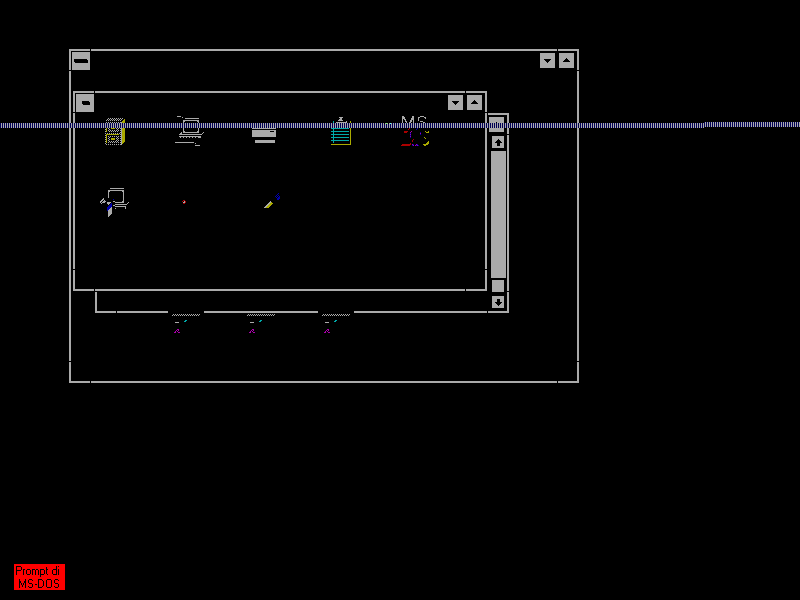

# Windows Enhanced: MS-DOS Prompt regression

The current `images/hdd.img` boots Windows with the S3 Trio driver, but
opening the MS-DOS Prompt exits Windows. EMM386 now installs successfully;
that fix alone did not resolve this regression.

Run the reproduction on a temporary copy of the disk:

```sh
dotnet run --project tools/WindowsDosProbe -c Release -- images/hdd.img /tmp/windows-dos
```

The probe clicks the Prompt icon at (415,130), launches it with Enter, runs
MEM, and types EXIT. Optional final arguments override the icon coordinates
for another desktop layout. It saves PPM screenshots, machine snapshots,
and an interrupt trace. Snapshots are diagnostic captures, not substitutes
for a matching disk snapshot. The source image is never modified.

A successful run requires the S3 graphics mode to return after EXIT; inspect
the screenshots to confirm Program Manager and its contents as well. The
current image is expected to fail that check. Do not treat a retained
800×600 framebuffer as proof that Windows survived.

The measured failure switches CR3 from Windows' 0043D000h to EMM386's
00118000h. The real-mode exit stubs at 1B2F:0655 and 1ABE:029B issue
INT 21h AX=4CFFh. MEM subsequently reports 533K conventional memory free.
This is the underlying DOS prompt, not a Windows DOS virtual machine.

Three separate rendering defects exposed by this sequence are fixed:

- Legacy INT 10h AH=00h mode changes now clear the VBE mode and its banking,
  scanline and display-start state. Returning to mode 03h displays the text
  console at 720×400 instead of stale S3 pixels with the text palette.
- The renderer refreshes the background under a stationary hardware cursor
  before composing it on a changed frame. XOR pixels no longer invert a
  second time when an unrelated row changes. Tests cover text and graphics.

- Text-cursor moves and hiding now invalidate the old row, even when no
  video memory is written. `TextCursorRenderingTests` checks both cases
  against a full redraw; the guest previously left 36 stale caret pixels.

The BIOS mode interfaces are described in the
[VESA VBE 2.0 specification](https://www.phatcode.net/res/221/files/vbe20.pdf).
`VesaTests` covers legacy mode changes, including the preserve-screen bit;
`S3HardwareCursorTests` compares incremental rendering with a full redraw.
Validation on 10 September 2026: all 1,239 non-slow unit tests pass.
The cold-boot probe reaches S3 Program Manager at 800×600, then the DOS
console at 720×400. All four captures have zero incremental/full-render
pixel differences. The final desktop-return check still fails, as expected.
The cause of the Windows termination remains under investigation.

Before the mode-state fix, opening the Prompt left this stale S3 image:



After the fix, the same transition shows the underlying DOS console:


