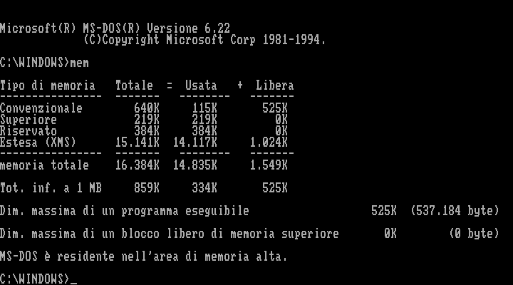
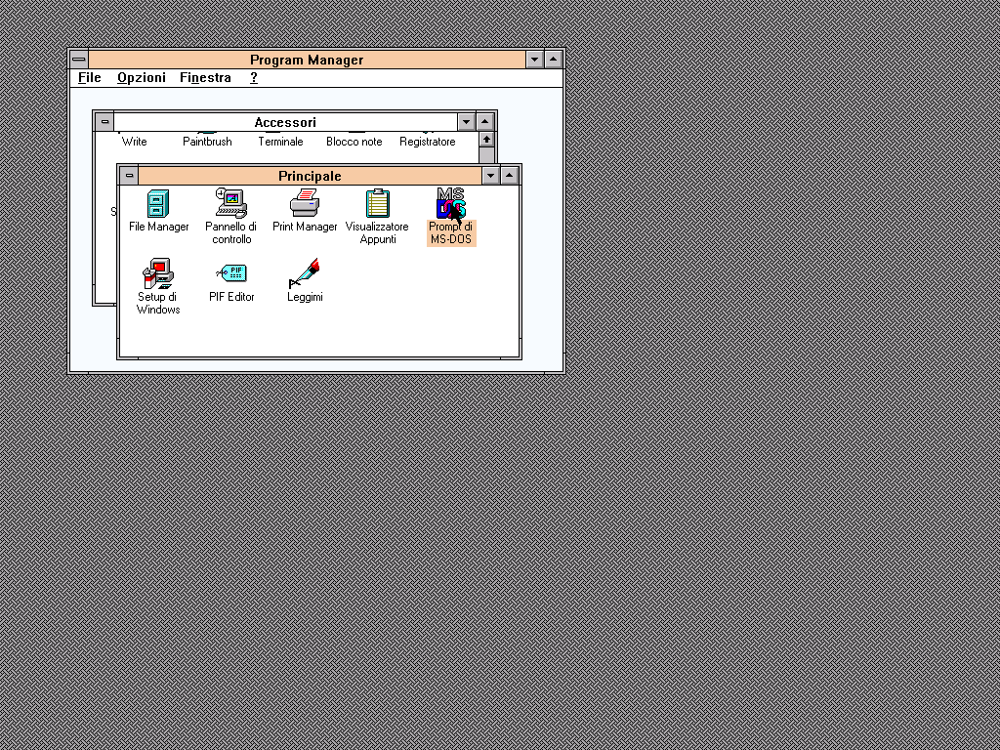

# Windows Enhanced: MS-DOS Prompt regression

The full-screen MS-DOS Prompt now opens under Windows Enhanced with the
S3 Trio driver, runs MEM, and returns to Program Manager with EXIT.
The CPU correction preserves ESP when a POP destination faults, so Windows
can page in the destination and retry the instruction without losing stack
contents.

Run the reproduction on a temporary copy of the disk:

```sh
dotnet run --project tools/WindowsDosProbe -c Release -- images/hdd.img /tmp/windows-dos 461 210
```

The final arguments give the Prompt icon coordinates for the current
1024×768 desktop. Without them the probe uses (415,130), matching the earlier
800×600 layout. Adjust them if the group window has moved. The PIF must use
full-screen mode: the probe explicitly checks that a text console opened,
so clicking a different icon cannot produce a false success.

The probe selects the icon, launches it with Enter, runs MEM, and types
EXIT. It saves PPM screenshots, machine snapshots, and an interrupt trace.
Snapshots are diagnostic captures, not substitutes for a matching disk
snapshot. The source image is never modified. A successful run requires the
S3 graphics mode to return after EXIT; inspect the screenshots to confirm
Program Manager and its contents as well.

## Cause measured in the guest

The earlier runs exited Windows with INT 21h AX=4CFFh and returned from
Windows' CR3=0043D000h to EMM386's CR3=00118000h. Working UMBs alone did not
resolve it. A ring of 262,144 instructions exposed the earlier stack error:

- At 0028:8001493E, `POP dword ptr [EAX+87h]` writes to 83C00487h and faults.
  ESP was 80010BB0h before the instruction.
- The emulator had already consumed the stack dword. Windows' page-fault
  handler returned to the same instruction with ESP=80010BB4h.
- Retrying skipped another dword. The later RET at 80014992h jumped into
  the VM data block at 807BB2E4h instead of back to 8001567Bh. The resulting
  protection fault caused VM destruction and Windows termination.

POP now restores ESP if the stack read or destination write raises a page
or segment fault. ESP-based destinations still use the pointer after the
pop. Four regressions cover 16/32-bit operands and destinations within a
missing page or spanning its boundary. Each delivers a real #PF through an
IDT gate, maps the missing page, returns with IRETD, and verifies that POP
consumes exactly one value. Restartable page faults are described in the
[Intel 80386 reference manual, section 9.8.14](https://www.ardent-tool.com/CPU/docs/Intel/386/manuals/prref386/s09_08.htm).

Validation on 10 September 2026: **1,243 non-slow unit tests** and all
**6,100 protected-mode hardware vectors** pass. A cold boot of the current
image completes the full DOS round trip at 1024×768. All four captures have
zero incremental/full-render differences, and CR3 remains 0043D000h under
Windows throughout the DOS session and return.

## Rendering corrections found during the investigation

Three separate rendering defects also affected the failed transition:

- Legacy INT 10h AH=00h mode changes now clear the VBE mode and its banking,
  scanline and display-start state. Returning to mode 03h displays text at
  720×400 instead of stale S3 pixels with the text palette.
- The renderer refreshes the background under a stationary hardware cursor
  before composing it on a changed frame. XOR pixels no longer invert a
  second time when an unrelated row changes.
- Text-cursor moves and hiding invalidate the old row, even when no video
  memory is written. The guest previously left 36 stale caret pixels.

`VesaTests`, `S3HardwareCursorTests`, and `TextCursorRenderingTests` cover
these cases, including comparisons against full redraws.

Before the mode-state fix, opening the Prompt left stale S3 graphics:


With the CPU fix, MEM runs inside the Windows DOS session:



EXIT returns to Program Manager:


