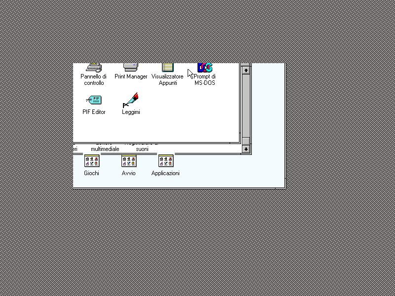

# Windows 3.1 with the S3 Trio64V+ driver

For the corresponding Windows 95 measurements, see
[Windows 95 and the S3 Trio64V+](WINDOWS95-S3.md).

The installed S3 driver needs its matching enhanced-mode virtual display
driver. Selecting only `S3TRIO.DRV` while retaining the generic VGA VDD
does not establish a working S3 display. On the DOS 6.22 / Windows 3.11
image used for the September 10 regression, that combination switched to
800×600 but left the display black.

The files already present in `C:\WINDOWS\SYSTEM` are `S3TRIO.DRV`,
`VDDS3764.386`, and `VGA_ENG.3GR`. The relevant entries in
`C:\WINDOWS\SYSTEM.INI` are:

```ini
[boot]
display.drv=s3trio.drv
386grabber=vga_eng.3gr

[386Enh]
display=vdds3764.386

[DISPLAY]
screen-size=800
color-format=8
dpi=96
```

Keep the other entries and CRLF line endings. Start with `win` (enhanced
mode). This S3 driver explicitly rejects `win /s`; the standard-mode
regression uses `vga.drv` on a separate image copy.

## Window-move regression

Dragging Program Manager 80 pixels right and down produced command
`C053h`: source `(579,383)`, size `512×336`, foreground mix `0067h`.
Both direction bits were clear. The driver supplied the bottom-right
corner as the first pixel to transfer; the emulator incorrectly added
positive offsets to that corner, copying an entirely different rectangle.
Only fragments of the window remained.

`S3Accelerator.CopyRectangle` now advances from the programmed coordinates
by +1 or −1 independently on each axis. The unit regression checks all
four directions with overlapping source and destination, comparing against
an untouched copy of the original pixels. This agrees with the direction
handling in [DOSBox-X's S3 engine](https://github.com/joncampbell123/dosbox-x/blob/master/src/hardware/vga_xga.cpp)
(`XGA_BlitRect`).

Before the fix:



After the same mouse input:


## Reproducing the guest check

```sh
dotnet run --project tools/S3WindowsProbe -c Release -- images/hdd.img /tmp/s3-probe
```

The probe boots a temporary copy, types `win`, captures the desktop, moves
its title bar, and saves `before.ppm`, `moved.ppm`, and `commands.log`.
It renders incrementally throughout execution and compares each capture
against a full redraw; both captures had zero differing pixels. It uses
COM1 mouse input and reads the S3 hardware cursor position to guide the
movement. The default title-bar point is `(300,60)`, matching the current
image; supply two extra coordinates for another desktop layout.

The screenshots verify the configured 800×600, 256-colour mode. Other
colour depths and the remaining line/polygon operations are separate
coverage work; this regression does not establish their completeness.
